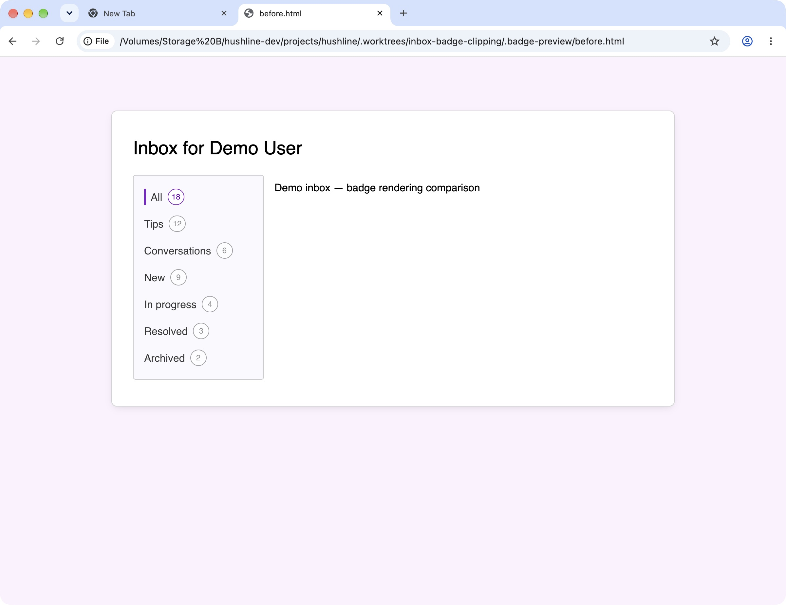
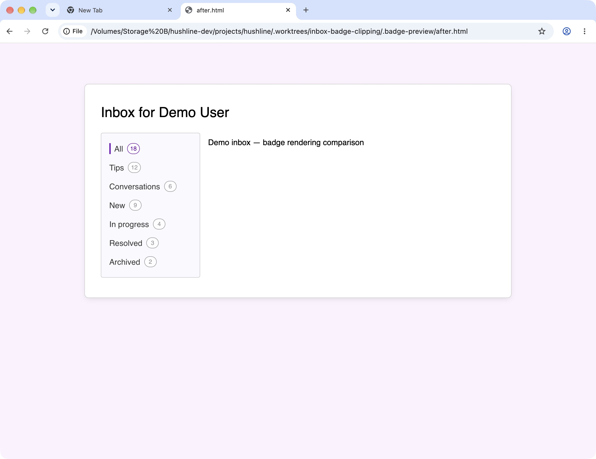

# Inbox badge rendering

These Chrome screenshots compare the inbox tab component with the compiled stylesheet
from `4ce8770c` (`before.png`) and this branch (`after.png`). Both use the repository
fonts, the same markup and demo counts, the same browser window, and default badge
padding. They are component previews, not screenshots of a signed-in account.

The change removes the inbox badge's extra line height and keeps inbox tabs out of
forced GPU compositing. Padding is unchanged. The screenshots show the resulting
badge sizing; the reported one-pixel clipping was not reproduced on this display,
so these images alone do not establish that every affected browser is fixed.

For manual regression testing, open the inbox on desktop and mobile, check active
and inactive badge bottom borders, and repeat with vertical badge padding of
`0.25rem`, `0.215rem`, and `0.125rem`. Check light and dark themes, browser zoom,
and horizontal tab scrolling on mobile. The Playwright test covers badge bounds
within the scroll container at these padding values and both viewport sizes;
it does not detect GPU rasterization artifacts.
